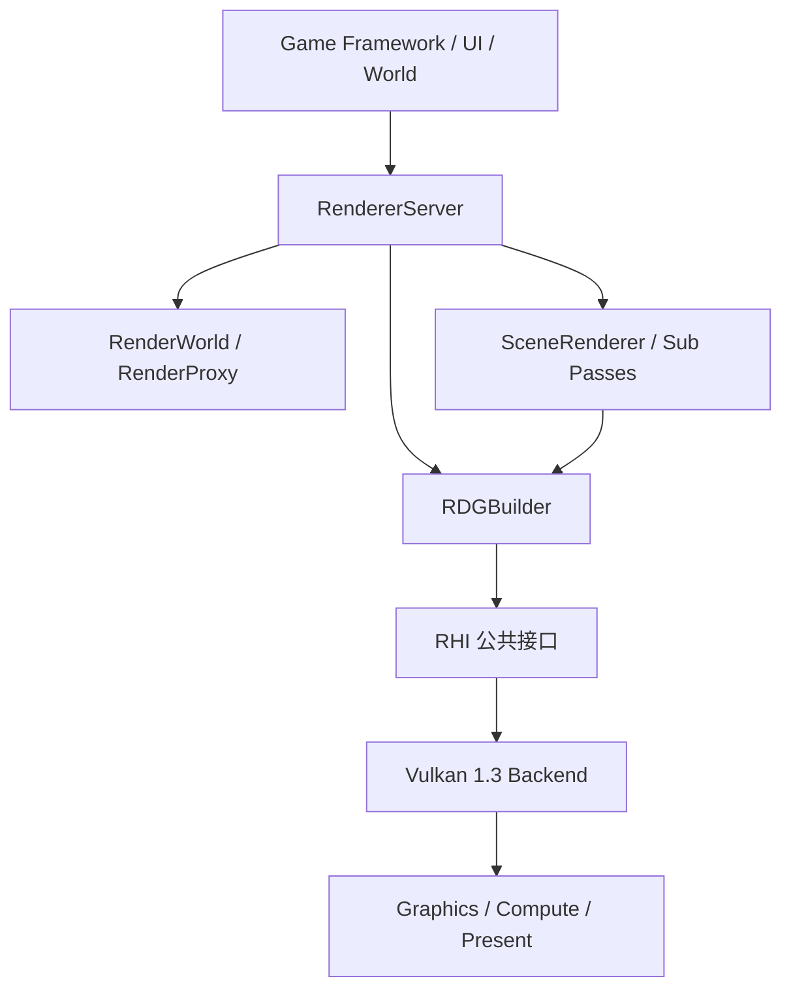

从整体来看, 渲染系统大致分为三个线程: Game 线程, Render 线程, RHI 线程(GPU)

Game 通过将渲染指令推入渲染指令队列, Render 线程读取渲染指令队列进行渲染; Render 线程将渲染相关数据转换为 RHI 数据, 并推入 RHI 封装好的硬件渲染队列中.

# RenderProxy

# Material 

# RDG

## 1. 总体目标与分层

渲染系统的核心目标：

1. 以 RHI 抽象统一 Vulkan 等后端能力。
2. 在 Renderer 层承载策略（材质、反射、批处理、RDG 编排）。
3. 保持 2D/UI 与 3D 在同一帧图内协同执行。
4. 明确能力边界：支持什么、不支持什么必须可观测。

推荐分层：

依赖方向必须是单向：业务 -> Renderer -> RHI -> 后端。

---

## 2. 线程与帧执行主线

从运行时视角，系统可抽象为：

- Game 线程：产生渲染意图与代理数据。
- Render 线程：汇总可见对象，构建 RDG，录制命令。
- GPU 队列：执行提交并呈现。

单帧路径（简化）：

1. 等待当前 FrameContext 的完成值。
2. Acquire 交换链图像。
3. 构建 RenderWorld 提交数据与 UI 批次。
4. 构建 RDG（导入 Backbuffer，添加 3D 与 UI Pass）。
5. 编译并执行 RDG，记录 Barrier 与 Draw/Dispatch。
6. Submit（Timeline + 二值信号量），随后 Present。

WSI 异常处理边界：

- OutOfDate/Suboptimal：重建交换链。
- SurfaceLost：先恢复 Surface，再恢复 Swapchain。
- DeviceLost：视为终态，重建 RHI/Device/资源。

---

## 3. RHI 核心契约

### 3.1 三个独立概念

1. Rendering Scope：一次真实附件绑定与渲染范围（begin/endRendering）。
2. Pipeline Compatibility：图形管线与附件签名兼容性（RenderingSignature）。
3. Logical Pass：上层逻辑 Pass（资源依赖、排序、裁剪、调度）。

公共 RHI 不暴露持久 RenderPass/Framebuffer；使用 Dynamic Rendering。

### 3.2 CommandList 约束

- 状态机：Initial -> Recording -> Executable -> Pending -> Completed。
- Draw 必须在 Graphics Rendering Scope 内。
- Dispatch 必须在 Scope 外。
- Barrier 显式记录，不做隐式资源状态转换。

### 3.3 Dynamic State

动态状态的“声明集合”属于 Pipeline 契约，会进入 Pipeline 语义键；
动态状态“运行时值”属于命令流，不进入 Pipeline 键。

---

## 4. Pipeline 与缓存

### 4.1 不可变对象

- Shader、BindGroupLayout、PipelineLayout、Pipeline 创建后不可变。
- 变化通过创建新对象表达。

### 4.2 PipelineManager 责任

- 语义键去重。
- 并发创建保护。
- 与驱动级 PipelineCache 分工协作（前者做语义，后者做二进制加速）。

### 4.3 当前 MaterialSystem 中的关键约束（已落地）

1. Graphics Pipeline 必须提供顶点语义（VertexInput/Topology）。
2. VertexFactory 与 Material 正交拆分；材质模板不再持有 legacy 顶点输入字段。
3. 提交关键路径已强制携带 VertexFactory（无效则拒绝/跳过）。

---

## 5. BindGroup 与 Shader 反射

### 5.1 角色边界

- RHI：资源对象、布局创建、描述符分配、命令绑定、设备能力校验。
- Renderer：SPIR-V 反射、跨阶段 ABI 合并、语义名解析与自动装配 BindGroup。

### 5.2 关键不变量

1. Layout 是 ABI，BindGroup 是数据快照。
2. BindGroup 创建后不可变。
3. DynamicOffset 是绑定策略，不是资源类型。
4. 反射只描述 ABI，不决定运行时绑定来源。

### 5.3 Vulkan 路径

- Descriptor Arena 负责池页扩展与回收。
- CommandList 绑定时校验设备归属、布局兼容、动态偏移数量与范围。
- 记录期间持有被引用资源，防止悬垂。

---

## 6. RenderWorld / RenderProxy / RenderData

### 6.1 RenderProxy 世界模型

- RenderProxy 表示可渲染对象在渲染器侧的只读代理。
- RenderWorld 聚合代理，维护增量变更标记（Transform/Material/Geometry/Visibility 等）。

### 6.2 交换数据协议

- 3D：DrawPacket（管线、绑定组、VB/IB、绘制参数、排序键）。
- 2D/UI：UIQuad 与 UIRenderBatch（分层排序与合批）。

### 6.3 增量渲染意图

- 无变化时尽量复用上一帧。
- 仅在受影响维度做局部重建（如材质变更仅更新绑定组）。

---

## 7. RDG 体系：编排主干与算法扩展

当前存在两层互补能力：

1. RDGBuilder 主干：负责帧编排与执行入口。
2. rdg 算法扩展：提供拓扑排序、Pass 裁剪、生命周期分析、显存别名计划与验证。

### 7.1 RDGBuilder（工程主线）

- 导入外部资源（Backbuffer 等）。
- 声明 Pass（Graphics/Compute/Copy）。
- 推导并插入必要 Barrier。
- 在执行阶段录制 begin/endRendering 与命令。

### 7.2 rdg 算法扩展（可收敛入主干）

- 依赖图构建：RAW/WAR/WAW。
- 拓扑排序：稳定顺序。
- 生命周期：[FirstUse, LastUse]。
- Pass 裁剪：删除对最终输出无贡献链。
- 显存别名：按堆和生命周期规划 slot。

### 7.3 显存别名与 RHI 扩展

为实现真实别名，RHI 需要支持：

- TransientHeap 创建。
- PlacedBuffer/PlacedImage 创建与绑定。
- 资源内存需求查询（对齐、类型位）。

缺失能力时必须退化到独立资源路径，保证功能可用而非失败。

---

## 8. 2D/UI 与 3D 统一渲染流程

### 8.1 2D/UI 推荐流程

1. 收集 UI/Sprite/Glyph 生成统一实例。
2. 生成排序键（Layer/Blend/Material/Texture）。
3. 稳定排序并合批。
4. 通过 UI Pass 合入同一 RDG。

### 8.2 3D 推荐流程

常见 Pass 链：

1. Shadow
2. Depth Prepass
3. Opaque（Deferred 或 Forward+）
4. Transparent
5. PostProcess
6. UI 合成
7. Present

RenderGraph 负责资源与同步正确性，Pass 只关心本阶段读写与绘制。

---

## 9. 同步、上传、读回与延迟销毁

### 9.1 同步原则

- 正常逐帧路径避免 waitIdle。
- 以 Timeline/Fence 完成值作为复用与销毁依据。

### 9.2 上传策略

- 推荐 Renderer 层 Upload Ring（持久映射 + 对齐分配 + 批量拷贝）。
- 非 coherent 内存执行 flush/invalidate。

### 9.3 延迟销毁

- 资源销毁应绑定 completion timeline value。
- collect 时仅释放“已确定 GPU 不再引用”的对象。

---

## 10. Material 与 VertexFactory（当前状态）

### 10.1 已完成

1. Material 与 VertexFactory 正交分离。
2. Pipeline 请求按 Pass + VertexFactory 组合。
3. Material 参数句柄缓存与纹理绑定缓存。
4. BindGroup 缓存生效，UBO 偏移已纳入缓存键与绑定描述。
5. 热重载后参数缓存与绑定缓存按模板身份版本失效。

### 10.2 当前约束

- Graphics pipeline 若缺少顶点语义覆写会拒绝创建。
- Render 提交路径必须传 VertexFactory。

---

## 11. 测试与验证建议

建议保留三类验证：

1. CPU 图算法测试：依赖、排序、裁剪、别名、屏障推导。
2. GPU 集成测试：堆/placed 资源、别名执行、回退路径。
3. 运行时 smoke：完整一帧录制、提交与呈现。

---

## 12. 已知边界与后续路线

### 12.1 仍需推进

1. Pipeline 缓存预算与 LRU 淘汰策略。
2. 异步预热（需先确认 RHI createPipeline 线程模型）。
3. RenderGraph 主干收敛算法扩展能力（拓扑/裁剪/别名）。
4. 多队列与 ownership transfer 自动调度。
5. UI 文本完整链路（FontAtlas + GPU 批次上传）完善。

### 12.2 维护策略

从现在起，渲染架构与契约更新优先维护本文件；其他文档保留为历史细节参考，避免出现多份“权威版本”。